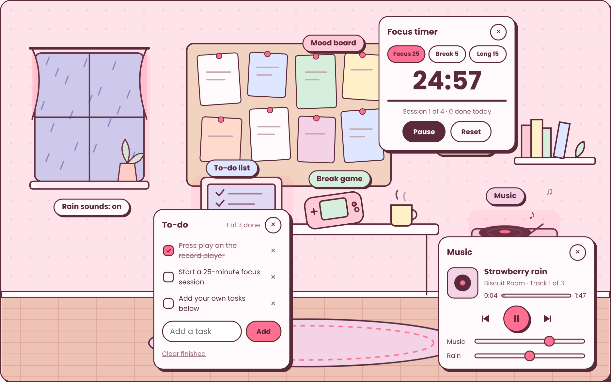

# Biscuit Room

A cozy online study room. Every object in the illustrated room does something:

| Object | What it does |
| --- | --- |
| Record player | Lo-fi music player. The music is composed live in the browser with the Web Audio API. |
| Window | Turns rain sounds and a rain animation on and off. |
| Wall clock | Focus timer: 25-minute focus sessions, 5-minute breaks and a long break after every fourth session. |
| Laptop | To-do list, saved in your browser. |
| Corkboard | **Biscuit Pins**: a Pinterest-style mood board. Search free Unsplash photos, save them to boards, and create, rename and delete boards. Your latest pins appear on the corkboard. |
| Handheld | **Biscuit Arcade**: a pastel pocket console with Snake, Memory cards and 2048, high scores and sound effects. |

**Live demo:** https://rayyanmajid344-creator.github.io/biscuit-room/

## Built with

- HTML, CSS and plain JavaScript (no frameworks, no build step)
- Inline SVG illustration, scaled responsively, with CSS animations
- Web Audio API for generated music, rain ambience, the timer chime and arcade sounds
- Unsplash API for photo search
- Canvas 2D for the arcade games
- `localStorage` for to-dos, boards, pins, high scores and settings

## Things worth looking at in the code

- **`js/audio.js`**: a small lo-fi engine. It schedules chords, pads, bass, drums, a melody and vinyl crackle a few milliseconds ahead using the audio clock, with swing on the off-beats. Rain is filtered brown noise with random droplets.
- **`js/pins.js`**: Unsplash search with paging, a masonry layout, boards stored as JSON, and the photographer credits Unsplash requires.
- **`js/arcade.js`**: three games sharing one input system (keyboard, on-screen buttons, swipes and taps) and a scene loop on `requestAnimationFrame`.
- **`js/app.js`**: the timer uses an end timestamp instead of counting ticks, so it stays accurate when the tab is in the background.
- **Accessibility**: every object is a real `<button>` with a label, panels and apps close with Esc, focus returns to whatever opened them, and animations respect "reduce motion".
- **Phones**: the room scales down, a button bar appears under it, panels open as bottom sheets, and the console turns upright.

## Run it locally

Download the folder and open `index.html` in Chrome, Edge or Firefox. No server is needed.

## Unsplash key (for Biscuit Pins)

1. Create a free account at [unsplash.com](https://unsplash.com/join).
2. Go to [unsplash.com/oauth/applications](https://unsplash.com/oauth/applications) and click **New Application**. Accept the guidelines, name it "Biscuit Room" and create it.
3. Copy the **Access Key** (never the Secret Key).
4. While testing, paste it into the box Biscuit Pins shows. Before publishing, paste it into `js/config.js` so visitors don't need their own key.

A new key allows 50 searches an hour. Before sharing the site widely, apply for production access on the same Unsplash page (1,000 searches an hour, free).

## Add your own music

See [`music/README.md`](music/README.md).

## Credits

Design and code by Rayyan Majid. Photos from Unsplash, credited on each photo. Fonts: Poppins and VT323 (Google Fonts, SIL Open Font License).
